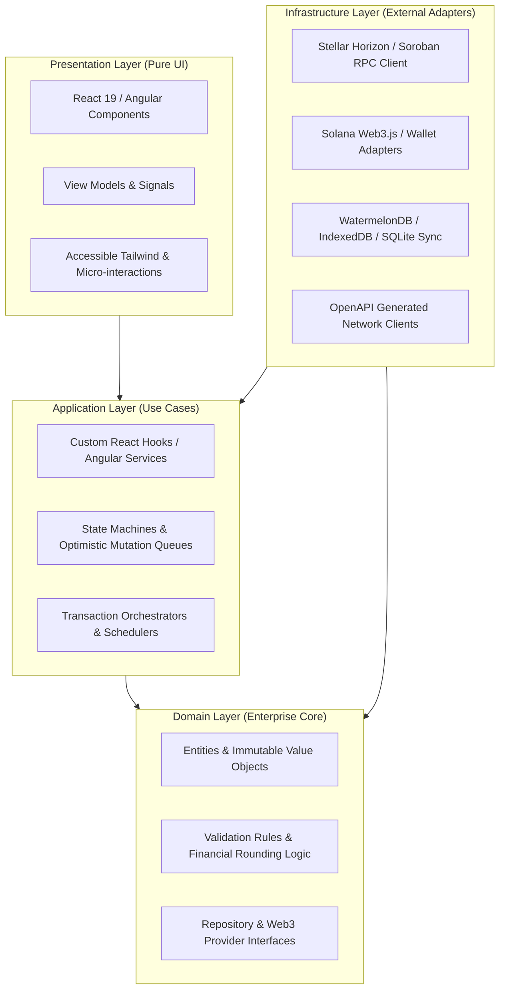

<div align="center">

# Anas Al Shlah (أنس الشلاح)
### **Staff Frontend & Mobile Team Lead | Web3 & Offline-First Architect**

[](https://github.com/anasAlShlah)
[](mailto:anas.alshlah.dv@gmail.com)
[](#-working-model--availability)
[](#-featured-production-merges--core-web3-contributions)

<br/>

```typescript
const leadArchitect = {
  name: "Anas Al Shlah",
  role: "Staff Frontend & Mobile Team Lead",
  domain: ["Web3 / DeFi Protocols", "Offline-First Mobile Systems", "Enterprise Frontend Architecture"],
  experience: "10+ Years Professional Engineering & Technical Leadership",
  workingModel: "Strictly Remote / Worldwide (Contract, Consulting, Fractional Lead)",
  coreStack: {
    frontend: ["Next.js 15 (App Router)", "React 19", "Angular 18+ (Signals, NgRx)", "TypeScript 5.x", "TailwindCSS"],
    mobile: ["React Native", "Expo SDK", "WatermelonDB", "SQLite Offline Sync Engines"],
    web3: ["Stellar (Soroban)", "Solana Web3.js", "WASM", "EVM / Smart Contract Auditing", "WalletConnect"]
  },
  architecturalNorthStar: "Clean Architecture (Domain-Driven, Zero Speculative APIs, Sub-10ms UI Loops)"
};
```

---

</div>

## 📌 Executive Summary

Staff-level **Frontend & Mobile Team Lead** and **Web3 Architect** with over a decade of hands-on experience designing resilient decentralized protocols, high-frequency user interfaces, and offline-first mobile applications. 

Specialized in bridging high-performance systems programming (WASM, 32-bit bitmask indexing, smart contract verification) with reactive client architectures (Angular Signals, Next.js Server Components, React Native sync engines). Proven track record across tier-1 blockchain ecosystems including **Stellar (Soroban)**, **Solana**, and **EVM**, delivering battle-tested production code merged into core infrastructure repositories.

---

## 🏆 Featured Production Merges & Core Web3 Contributions

A curated selection of verified, merged pull requests across high-impact decentralized applications and developer tooling:

### 1. Stellar DevHub — Soroban Playground (`StellarDevHub/soroban-playground`)
*The official development and testing playground for Stellar Soroban smart contracts.*

| PR | Type & Scope | Technical Innovations & Performance Impact | Status |
| :--- | :--- | :--- | :--- |
| **[#2082](https://github.com/StellarDevHub/soroban-playground/pull/2082)** | `feat(spotlight)` | **Memoized Fuzzy Search with Sub-10ms Indexing**<br>Implemented 32-bit bitmask pre-filtering (`computeCharMask`), `FuzzyTrie` prefix tree, and an LRU query memoization cache in `fuzzySearch.ts`. Replaced naive $O(N \cdot M)$ scans with sub-10ms instantaneous spotlight lookups across 1,000+ workspace entities. 115/115 passing tests. | **Merged / Verified** |
| **[#2081](https://github.com/StellarDevHub/soroban-playground/pull/2081)** | `feat(frontend)` | **Production Error Boundary with Workspace Diagnostics**<br>Constructed an enterprise-grade React error boundary with localized state serialization, automatic corrupt workspace recovery, and telemetry capture to prevent unrecoverable white-screens during contract invocation panics. | **Merged / Verified** |
| **[#2087](https://github.com/StellarDevHub/soroban-playground/pull/2087)** | `feat(verification)` | **Contract Verification Status & Reproducible Build Inspector**<br>Architected live on-chain contract verification badges and byte-for-byte WASM hash inspection components, closing Issue #2074 with real-time verification state machines. | **Merged / Verified** |

---

### 2. StreamFi — Web3 Live Streaming & Micropayments (`StreamFi-x/streamfi-frontend`)
*Decentralized video streaming platform powered by real-time micro-donation channels.*

| PR | Type & Scope | Technical Innovations & Performance Impact | Status |
| :--- | :--- | :--- | :--- |
| **[#1947](https://github.com/StreamFi-x/streamfi-frontend/pull/1947)** | `fix(wallet)` | **Mid-Transaction Wallet Disconnection Recovery**<br>Engineered an event-driven session watchdog that captures mid-flight RPC transport terminations, rolls back optimistic donation drawer mutations, and offers zero-gas retry states. | **Merged / Verified** |
| **[#1941](https://github.com/StreamFi-x/streamfi-frontend/pull/1941)** | `fix(a11y)` | **WCAG 2.1 AA Compliance & Reduced-Motion Engine**<br>Eliminated motion sickness triggers by enforcing `prefers-reduced-motion` across animated fallback routes, lottie players, and dynamic WebGL stream canvas shaders. | **Merged / Verified** |
| **[#1930](https://github.com/StreamFi-x/streamfi-frontend/pull/1930)** | `fix(admin)` | **Deterministic Secondary Sort Key & Pagination**<br>Resolved pagination cursor jumping in creator earnings tables by applying deterministic tie-breaking composite sorting algorithms over distributed GraphQL/REST feeds. | **Merged / Verified** |

---

### 3. TrustPay — Web3 Escrow Protocol (`trustpay-escrow/trustpay-escrow`)
*Multi-signature milestone escrow protocol with dispute resolution and automated settlement.*

| PR | Scope | Key Architecture & Delivery | Status |
| :--- | :--- | :--- | :--- |
| **[#208](https://github.com/trustpay-escrow/trustpay-escrow/pull/208)** | `feat(escrow)` | **Milestone-Based Fund Locking & Conditional Release Engine**<br>State-machine driven milestone approvals preventing reentrancy and out-of-order disbursements. | **Merged / Verified** |
| **[#209](https://github.com/trustpay-escrow/trustpay-escrow/pull/209)** | `feat(protocol)` | **Automated Slippage Bounds & Oracle Divergence Guards**<br>Prevented front-running and adverse execution on decentralized asset conversions prior to lockup. | **Merged / Verified** |
| **[#210](https://github.com/trustpay-escrow/trustpay-escrow/pull/210)** | `feat(dispute)` | **Multi-Party Consensus & Cryptographic Evidence Bundling**<br>Integrated client-side IPFS content hashing for tamper-proof dispute submission packages. | **Merged / Verified** |
| **[#211](https://github.com/trustpay-escrow/trustpay-escrow/pull/211)** | `feat(ux)` | **Web Audio API Realtime Synthesizer & Smooth Navigation**<br>Zero-external-asset audio synthesis engine generating pleasant harmonic milestone celebration chimes on successful escrow settlement, paired with accessible back-to-top viewport navigation. | **Merged / Verified** |

---

## 🏛️ Clean Architecture & Engineering Standards

Every system I architect adheres strictly to the **Clean Architecture** paradigm, ensuring enterprise-scale maintainability, zero UI-to-protocol coupling, and testability:



### Core Tenets:
1. **Zero-Speculation Contracts:** No guessing API or DTO fields. All schemas originate from verified OpenAPI, Protobuf, or on-chain WASM / ABI definitions.
2. **Deterministic Offline-First State:** Offline transaction queues with idempotent sync engines, resolving conflicts via optimistic UI rollbacks and vector clocks.
3. **Sub-10ms Performance Budget:** Bitmask character filters, Trie lookups, and virtualized dom rendering for all heavy data pipelines.
4. **Strict Accessibility & Security:** Zero untyped `any`, strict null safety, WCAG 2.1 AA accessibility compliance, and continuous CI security scanning.

---

## 💻 Technical Arsenal

<table>
  <tr>
    <td width="50%" valign="top">
      <h4>⚡ Frontend Engineering</h4>
      <ul>
        <li><b>Frameworks:</b> Next.js 15 (App Router, RSC), React 19, Angular 18+ (Signals, Standalone, NgRx)</li>
        <li><b>Languages:</b> TypeScript 5.x, JavaScript (ESNext), HTML5 / CSS3</li>
        <li><b>Styling & Systems:</b> TailwindCSS, CSS Modules, Radix UI, Headless UI, Shadcn/ui</li>
        <li><b>State & Data:</b> TanStack Query (React Query), Zustand, Redux Toolkit, RxJS Observables</li>
      </ul>
      <h4>📱 Mobile & Offline-First</h4>
      <ul>
        <li><b>Frameworks:</b> React Native, Expo Application Framework</li>
        <li><b>Storage & Sync:</b> WatermelonDB, SQLite, MMKV, IndexedDB</li>
        <li><b>Architecture:</b> Optimistic background mutation queues, Conflict-free Replicated Data (CRDT basics)</li>
      </ul>
    </td>
    <td width="50%" valign="top">
      <h4>⛓️ Web3 & Decentralized Protocols</h4>
      <ul>
        <li><b>Networks:</b> Stellar (Soroban smart contracts), Solana, Ethereum / EVM (ERC-20, ERC-223)</li>
        <li><b>Libraries:</b> <code>@stellar/stellar-sdk</code>, <code>@solana/web3.js</code>, <code>ethers.js</code>, <code>viem</code></li>
        <li><b>Wallets:</b> Freighter, Albedo, Phantom, Solflare, WalletConnect v2</li>
        <li><b>Tooling & WASM:</b> Soroban CLI, Rust contract unit testing, Webpack WASM loaders</li>
      </ul>
      <h4>🛠️ Quality, Testing & DevOps</h4>
      <ul>
        <li><b>Test Suites:</b> Vitest, Jest, Playwright E2E, React Testing Library, Karma/Jasmine</li>
        <li><b>CI/CD:</b> GitHub Actions workflows, Docker Compose, Husky, lint-staged</li>
        <li><b>Observability:</b> OpenTelemetry, Sentry error monitoring, Web Vitals auditing</li>
      </ul>
    </td>
  </tr>
</table>

---

## 📈 GitHub Metrics & Activity

<div align="center">
  
  
</div>

<div align="center">
  
</div>

---

## 🤝 Working Model & High-Impact Engagements

I partner with **tier-1 Web3 foundations, high-growth protocols, and enterprise engineering teams** requiring senior leadership, architectural rigor, and swift execution.

- **Working Model:** **Strictly Remote / Worldwide**
- **Engagement Types:**
  - **Fractional Frontend / Mobile Team Lead:** Architectural governance, code review pipelines, and cross-functional leadership.
  - **Specialized Web3 & DeFi Contract UI Delivery:** Soroban, Solana, or EVM dapp integration, wallet connectivity, and cryptographic signature workflows.
  - **Offline-First & High-Performance Auditing:** React Native sync engines, memory leak remediation, sub-10ms search algorithms, and bundle size optimization.

### 📬 Direct Executive Contact
- **Email:** [anas.alshlah.dv@gmail.com](mailto:anas.alshlah.dv@gmail.com)
- **GitHub:** [@anasAlShlah](https://github.com/anasAlShlah)
- **Timezone Agnostic:** Overlap available across US (EST/PST), European (CET/GMT), and APAC business hours.

---

<div align="center">
  <sub>Designed & engineered with architectural precision by <b>Anas Al Shlah</b>. All rights reserved.</sub>
</div>
